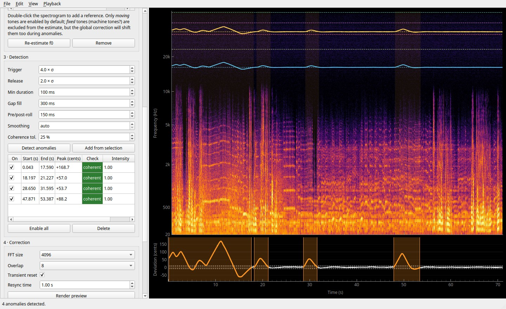
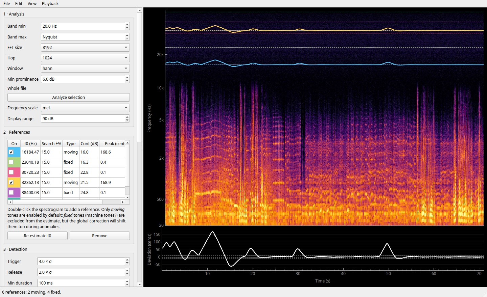
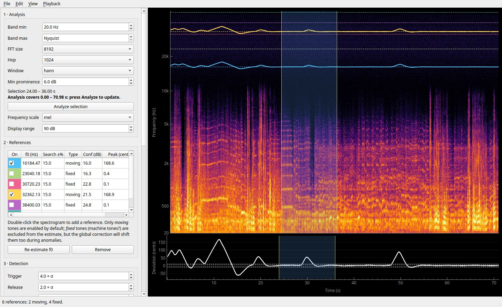
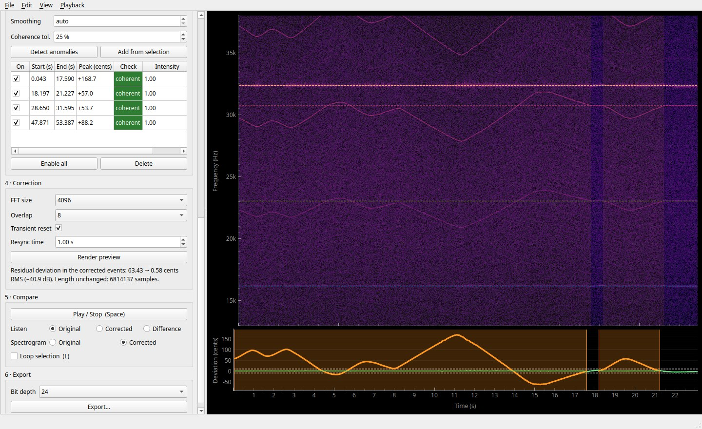

# deflutter

[](https://github.com/matteospanio/deflutter/actions/workflows/ci.yml)
[](LICENSE)

**deflutter** is a desktop app that corrects frequency drift (wow, flutter, tape-speed anomalies) in
audio recordings.

It needs a stable tone that was recorded together with the program: a pilot tone, mains hum, bias
leakage, a test tone. deflutter tracks that tone and measures how far it deviates from its nominal
frequency. It then pitch-corrects the whole recording by the same ratio, wherever the deviation
occurred. The sample count and the timing of every event stay the same.

Processing is deterministic and runs on your computer: no AI, no machine learning, no cloud.



## Download

| Platform | File |
|---|---|
| Windows 10/11 (64-bit) | [deflutter-windows-x64.exe](https://github.com/matteospanio/deflutter/releases/latest/download/deflutter-windows-x64.exe) |
| macOS, Apple Silicon (M1 or newer) | [deflutter-macos-arm64.zip](https://github.com/matteospanio/deflutter/releases/latest/download/deflutter-macos-arm64.zip) |
| macOS, Intel | [deflutter-macos-x86_64.zip](https://github.com/matteospanio/deflutter/releases/latest/download/deflutter-macos-x86_64.zip) |
| Linux x86_64 (glibc 2.35 or newer: Ubuntu 22.04+, Debian 12+, Fedora 36+, …) | [deflutter-linux-x86_64.tar.gz](https://github.com/matteospanio/deflutter/releases/latest/download/deflutter-linux-x86_64.tar.gz) |

These links always point to the latest release. Older versions and release notes are on the
[releases page](https://github.com/matteospanio/deflutter/releases).

## Installation

The downloads are self-contained: Python and every library are bundled, and there is no installer.
The binaries are not code-signed, so your system will warn you the first time you run one.

### Windows

1. Download `deflutter-windows-x64.exe` and double-click it.
2. If SmartScreen says *"Windows protected your PC"*, click **More info → Run anyway**.

The first start takes a few seconds while the app unpacks itself.

### macOS

1. Download the zip for your Mac and double-click it to extract `deflutter.app`.
2. Move `deflutter.app` to *Applications*.
3. The first time, **right-click the app → Open → Open**. A plain double-click is refused for apps
   from unidentified developers.
4. If macOS says the app *"is damaged and can't be opened"*, remove the download quarantine flag:

   ```sh
   xattr -dr com.apple.quarantine /Applications/deflutter.app
   ```

### Linux

```sh
tar -xzf deflutter-linux-x86_64.tar.gz
./deflutter                      # or: ./deflutter recording.wav
```

If the app fails with *"could not load the Qt platform plugin xcb"*, install the XCB cursor library.
On Debian/Ubuntu: `sudo apt install libxcb-cursor0`. Fedora: `sudo dnf install xcb-util-cursor`.

### From source (any platform)

You need Python 3.12 or newer and [uv](https://docs.astral.sh/uv/):

```sh
git clone https://github.com/matteospanio/deflutter.git
cd deflutter
uv sync
uv run deflutter
```

With plain pip instead: `pip install .` then `deflutter`.

## User guide

### What deflutter does

When a tape or disc plays at the wrong or an unsteady speed, every frequency in the recording is
multiplied by the same ratio `r(t)`. At 2 % too fast, a 1000 Hz note sounds at 1020 Hz and a 50 Hz hum
at 51 Hz. A tone that should be constant, a **reference**, shows that ratio directly. deflutter:

1. tracks one or more references and estimates their nominal frequency `f0`;
2. finds the time spans where they deviate (**anomalies**);
3. checks that all references deviate *together* (otherwise the cause is not a speed change);
4. divides every frequency by `r(t)` during the anomalies, without changing the duration.

### The window



- **Left panel.** The six steps of the workflow, top to bottom.
- **Top right: spectrogram.**
  - Tracked references are drawn as coloured curves, and their nominal `f0` as dashed lines.
  - Anomalies are shaded orange.
  - The frequency axis can be linear, log or mel.
- **Bottom right: deviation plot**, in cents. One cent is 1/100 of a semitone; 1 % ≈ 17 cents. It shows:
  - each enabled reference (thin, its own colour);
  - their combined deviation (white);
  - the detection thresholds (dashed);
  - the correction profile of each anomaly (orange);
  - the residual deviation after correction (green).
- **Status bar.** Time, frequency and level under the mouse, plus progress and **Cancel** for long
  operations.

To start, drop an audio file on the window, or use **File → New project from audio file**. Supported
formats: WAV, FLAC, AIFF, OGG/Vorbis, Opus and MP3, in mono, stereo or more channels, at any sample
rate. Every file becomes a *project*, saved automatically, and **File → Recent projects** lists them.

### Step 1 · Analysis



**Select the part to work on** by dragging with the left mouse button on either plot.
- Drag the edges of the blue region to adjust it.
- Press **Esc** to clear the selection, or **Ctrl+A** to select everything.
- With a selection, analysis, detection and correction stay inside it. Without one, they cover the
  whole file.
- Include some audio where the speed is correct. deflutter needs it to learn each reference's nominal
  frequency.

Then press **Analyze selection**. deflutter computes the spectrogram of the selection, finds tones that
persist through it, and follows each one frame by frame.

Analysis settings (the defaults suit most material):

| Setting | Meaning |
|---|---|
| Band min / max | Frequency range searched for references. *Nyquist* means up to half the sample rate. Pilot tones and bias leakage often sit above 15 kHz, hum below 200 Hz. |
| FFT size | Longer windows measure frequency more precisely but smooth out fast flutter. |
| Hop | Time step between analysis frames. |
| Window | `hann` is a good default; `blackmanharris` separates a weak tone from a strong neighbour better. |
| Min prominence | How far (dB) a tone must stand above the surrounding noise to be proposed. Lower it if a reference is missed. |
| Frequency scale, Display range | Display only: linear / log / mel axis and the colour range of the spectrogram. |

### Step 2 · References

The table lists the tones that were found:

| Column | Meaning |
|---|---|
| On | Use this tone to estimate the deviation. |
| f0 (Hz) | Nominal frequency: the robust median over the stable frames. Double-click to type the true value, if you know it. |
| Search ±% | How far from its starting frequency the tracker may follow the tone. |
| Type | *moving*: it shows real excursions. *fixed*: it never moves. |
| Conf (dB) | How far the tone stands above the noise. |
| Peak (cents) | Largest deviation in the analysed range. |

Only *moving* tones are enabled by default. *Fixed* tones were usually added after the recording, for
example by the playback or digitising chain, so they do not carry the speed error.

Note that the correction is global: during an anomaly it also shifts fixed tones, in the opposite
direction. You can see this in the [Step 4 screenshot](#step-4--correction).

- **Add a reference:** double-click a tone on the spectrogram. Tracking starts where you clicked.
- **Remove:** select rows and press **Remove**.
- **Re-estimate f0:** recomputes `f0` for the selected rows, or for all rows if none is selected.

Changing `f0` or switching references on and off updates everything instantly; the spectrogram is not
recomputed.

### Step 3 · Detection


Press **Detect anomalies**. An anomaly starts when the combined deviation exceeds the **Trigger**
threshold for at least **Min duration**. It ends when the deviation falls below the **Release**
threshold.

Both thresholds are multiples of σ, the robust noise level of the deviation. **Gap fill** merges
anomalies that are close together, and **Pre/post-roll** widens each one so the correction fades in and
out smoothly.

Each anomaly gets a smooth correction profile (orange). **Smoothing** sets the time scale of that
smoothing; *auto* lets the data decide.

The **Check** column tells you whether the anomaly really is a speed change:

| Check | Meaning | Enabled by default |
|---|---|---|
| coherent (green) | All enabled references deviate by the same ratio, within **Coherence tol.** | yes |
| unverified (yellow) | Only one usable reference | only if no *fixed* tone contradicts it |
| incoherent (red) | References disagree: probably not a speed change | no |

Hover over a check to see each reference's deviation. You can still force an anomaly on with its
checkbox or **Enable all**. Other edits:

- drag the orange edges in the deviation plot, or type **Start**/**End**;
- set **Intensity** (0–2 × the measured profile);
- **Add from selection** for a span the detector missed;
- **Delete** an anomaly;
- double-click the *Peak* or *Check* cell to zoom to the anomaly.

Every edit can be undone (**Ctrl+Z**) and redone (**Ctrl+Shift+Z**).

### Step 4 · Correction



Press **Render preview**. The enabled anomalies are corrected with a phase vocoder, and the references
are then tracked again on the result. The panel reports the residual deviation, before and after in
cents RMS, and the improvement in dB. The green curve in the deviation plot should sit on zero.

In the screenshot the two references, on the dashed lines, are now straight. The fixed machine tones
mirror the original drift, because the correction is global.

| Setting | Meaning |
|---|---|
| FFT size, Overlap | Phase-vocoder resolution. 4096 with overlap 8 is a good default; larger FFT sizes suit tonal material, smaller ones transients. |
| Transient reset | Keeps attacks crisp by resetting the phase where a sudden onset occurs. |
| Resync time | After each anomaly, the time over which the output glides back to the untouched original. |

The original file is never modified. Renders are cached, so rendering the same settings again is
instant.

### Step 5 · Compare

- **Play / Stop** (Space) plays the selection, or from the left edge of the view if there is none.
- **Listen** chooses *Original*, *Corrected* or *Difference* (what the correction removed or added).
  Press **B** to switch between original and corrected while playing.
- **Loop selection** (L) repeats the selection.
- **Spectrogram: Corrected** shows the spectrum after correction.

### Step 6 · Export

Choose the **Bit depth** (16, 24 or 32-bit float) and press **Export…** to save the corrected audio as
WAV or FLAC. FLAC does not support 32-bit float. The sample rate and channels are the same as the
source.

If the result exceeds full scale, the clipped samples are reported; use 32-bit float to avoid
clipping. The exported file is re-opened to check that its length matches.

### Mouse and keyboard

| Action | How |
|---|---|
| Select a time range | Left-drag on either plot; drag the edges to adjust |
| Pan | Middle-drag |
| Zoom | Mouse wheel or right-drag; over an axis, zooms only that axis |
| Add a reference | Double-click the tone on the spectrogram |
| Zoom to selection / whole file | F / 0 |
| Clear selection / select all | Esc / Ctrl+A |
| Play–stop / switch original–corrected / loop | Space / B / L |
| Undo / redo | Ctrl+Z / Ctrl+Shift+Z |
| New project / recent projects / export | Ctrl+N / Ctrl+O / Ctrl+E |

### Projects and files

Projects are saved automatically in an SQLite database, together with a cache of spectrograms and
renders:

| System | Location |
|---|---|
| Linux | `~/.local/share/deflutter` |
| macOS | `~/Library/Application Support/deflutter` |
| Windows | `%APPDATA%\deflutter` |

Deleting the `cache` folder there is safe; it is rebuilt when needed. A project stores the path of its
audio file. If you move the file, deflutter asks you to locate it.

### Tips and troubleshooting

- **No moving reference found.** The selection may lie entirely inside an anomaly. Widen it so it
  includes stable audio. Or double-click the drifting tone and type its nominal frequency in the *f0*
  column.
- **A reference jumps to another tone.** Lower its *Search ±%*, or use the `blackmanharris` window.
- **Fast flutter is not followed.** Use a smaller FFT size or hop in Analysis.
- **The correction sounds phasey.** Try a larger correction FFT size, or overlap 16.
- **Everything is flagged incoherent.** A *fixed* tone may be enabled: disable it. If the references
  really disagree, the problem is not a speed error and a global correction would do harm.

## How it works

- **Deviation.** For each reference, `e(t) = f_obs(t)/f0 − 1`. Frequencies are measured by
  frame-by-frame peak tracking on the STFT, refined by parabolic interpolation. `f0` is a robust median
  over the stable frames. With several references, the per-frame median of their deviations is used.
- **Detection.** Hysteresis thresholds on `|e|`, expressed in units of the MAD-based robust σ, plus
  minimum duration, gap filling and pre/post-roll.
- **Profile.** Each anomaly gets a smoothing-spline profile `ê(t)`, tapered to zero at its edges.
  Then `r(t) = 1 + Σ intensity · ê(t)`.
- **Correction.** The frequency map is `f_out = f_in / r(t)`. It is applied by a phase vocoder that
  stays on the original frame grid:
  - each output bin takes the magnitude found at source bin `k·r`;
  - its phase advances with the corrected instantaneous frequency;
  - identity phase locking keeps the bins around each peak coherent;
  - a peak whose level jumps up resets to the input phase, which keeps transients sharp;
  - stereo channels share one phase trajectory, so the stereo image is preserved.
- **Resync.** After an anomaly, the accumulated phase offset fades out over the resync time. From then
  on the output is bit-identical to the input.
- **Parallelism.** FFTs use all CPU cores. Separate anomalies are rendered in parallel worker
  processes. Long operations run in the background and can be cancelled.

The design document this follows is the Italian *AFC Studio* project plan, not included in this
repository.

## Limitations

- The correction is global: fixed tones added after the recording are shifted during anomalies. You
  can exclude them from the estimate, but removing them would need a different, additive model.
- Fast flutter is limited by the analysis window. The default 8192-point window is 85 ms at 96 kHz and
  170 ms at 48 kHz.
- One long anomaly is rendered on a single core, at about 0.7 ms per frame.
- Not implemented yet:
  - a settings dialog;
  - manual control points on the profile;
  - resampling or channel changes on export;
  - automatic cache cleanup.

## Development

```sh
uv sync                                  # dependencies, including pytest
uv run pytest -q                         # numerical tests on synthetic signals
uv run python -m deflutter.audio demo/   # synthetic test WAVs: step, gaussian, ramp, multi, nonglobal
uv run deflutter --smoke-test            # build the window without showing it, run a parallel render, exit
```

The code is in `deflutter/`:

| Module | Contents |
|---|---|
| `analysis.py` | STFT, tracking, detection, profiles |
| `correction.py` | Phase vocoder |
| `audio.py` | Audio I/O and the synthetic signal generator |
| `store.py` | SQLite and the cache |
| `plot.py` | Spectrogram and deviation plots |
| `ui.py` | Main window |

**Building a binary locally** (the same command CI uses; output in `dist/`):

```sh
uv run --with pyinstaller pyinstaller --noconfirm --windowed --onefile --name deflutter \
  --paths . --collect-data pyqtgraph deflutter/__main__.py
```

**Releasing.**
1. Bump the version in `pyproject.toml` and `deflutter/__init__.py`.
2. Push a tag:

   ```sh
   git tag v0.1.0 && git push origin v0.1.0
   ```

The [CI workflow](.github/workflows/ci.yml) then does the rest:
- runs the tests;
- builds the Windows, macOS (Apple Silicon and Intel) and Linux binaries;
- smoke-tests each binary;
- publishes them as a GitHub release.

The asset names never change, so the download links above always serve the newest version. To build
the binaries without releasing, run the workflow manually from the *Actions* tab; they appear as
workflow artifacts.

### Validation

- **Synthetic signals** (`tests/`):
  - tracking error under 1 Hz;
  - anomaly edges within 1–2 analysis hops;
  - profile RMS error under 10 % of the peak;
  - residual deviation reduced by 40–46 dB;
  - the sample count is unchanged, both channels are corrected and the stereo image is preserved;
  - renders are deterministic;
  - when a single component deviates, the anomaly is flagged and not corrected automatically.
- **A real 96 kHz recording** (the one in the screenshots):
  - the two reference tones are found as *moving*, and the four machine tones as *fixed*;
  - all 4 anomalies are coherent across both references;
  - the residual deviation drops from 63.4 to 0.6 cents RMS (−41 dB).

## License

Copyright © 2026 Matteo Spanio.

deflutter is free software: you can redistribute it and/or modify it under the terms of the GNU
General Public License as published by the Free Software Foundation, either version 3 of the License,
or (at your option) any later version. It is distributed in the hope that it will be useful, but
WITHOUT ANY WARRANTY; see [LICENSE](LICENSE) for the full text.
